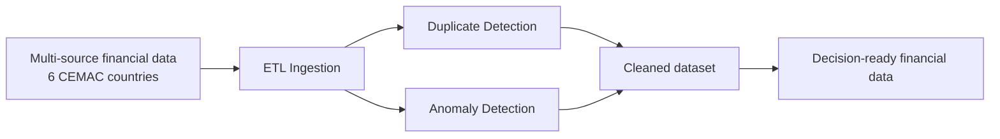

# SIDADR — Financial Anomaly & Duplicate Detection

> Automated ETL pipeline that caught data errors across 500,000+ regional financial records from 6 countries — before they reached decision-makers.

⚠️ **Data confidentiality**: built on proprietary, multi-source financial
data from BEAC (6 CEMAC member countries). Real data is **not included**
in this repository — the public version should run on a synthetic sample
dataset. See [Data](#data).

## Business Problem

A central bank aggregating financial data from 6 member countries through
multiple source systems faces a recurring risk: duplicate entries and
silent data errors that undermine the reliability of any downstream
reporting or policy decision built on that data.

## Solution

SIDADR (Système Intelligent de Détection des Anomalies et Duplications) is
an automated ETL pipeline that ingests multi-source regional financial
records, flags anomalies and duplicate entries, and produces a cleaned,
trustworthy dataset for decision-making.

## Architecture



## Tech Stack

- **Language**: Python (Pandas, NumPy)
- **Database**: MySQL
- **Query**: SQL

## Data

- ~500,000+ multi-source financial records covering 6 CEMAC member
  countries (proprietary, BEAC — **not published**)
- Public repo: use a synthetic sample dataset that mimics the same schema
  and error patterns *(TODO: generate before making the repo public)*

## Methodology

1. Ingest financial records from multiple regional source systems
2. Standardize schemas across sources
3. Detect duplicate records (entity resolution / matching rules)
4. Detect anomalies (rule-based and/or statistical outlier detection)
5. Produce a cleaned, validated dataset with an audit trail of
   corrections

## Results

- **-35% data error rate**
- Secured decision-quality data for 6 member countries

## Demo

*TODO: add a walkthrough (GIF or short video) of the pipeline run and
before/after data quality report, since this is a pipeline rather than an
interactive app.*

## Screenshots

*TODO: add before/after data quality metrics, sample anomaly report.*

## Installation

*TODO: verify exact entry point against the actual repo. Draft, to
confirm:*

```bash
git clone https://github.com/vloicmonti/sidadr-financial-anomaly-detection.git
cd sidadr-financial-anomaly-detection
pip install -r requirements.txt
python src/run_pipeline.py
```

## Project Structure

*TODO: replace with the real tree once verified against the code.*

```
sidadr-financial-anomaly-detection/
├── data/                  # sample/synthetic data only
├── src/
│   ├── ingestion.py
│   ├── duplicate_detection.py
│   ├── anomaly_detection.py
│   └── run_pipeline.py
├── reports/               # generated data quality reports
├── requirements.txt
└── README.md
```

## Future Improvements

- Add automated tests covering duplicate/anomaly detection edge cases
- Add a lightweight dashboard for data quality monitoring over time
- Parameterize detection rules per data source

## Author

**Vincent Loïc Monti**
[LinkedIn](https://www.linkedin.com/in/vincent-lo%C3%AFc-monti-981641388/) · [loicmonti318@gmail.com](mailto:loicmonti318@gmail.com)
