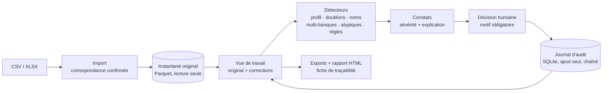

# SIDADR — Financial Data Quality & Anomaly Intelligence

[](https://github.com/vloicmonti/sidadr-financial-anomaly-detection/actions/workflows/ci.yml)

> **Système Intelligent de Détection des Anomalies et Duplications** dans des données financières multi-sources : import, profilage, doublons, noms similaires, clients multi-banques, valeurs atypiques, règles métier, corrections tracées et rapport qualité.

**Statut : v0.1 — moteur complet, interface web en cours.** Prototype local mono-utilisateur, testé sur des données **synthétiques**. Le moteur s'utilise en ligne de commande ou via l'interface React, dont les principaux écrans de revue sont livrés.

---

## Le problème

Une institution qui consolide des opérations venant de plusieurs banques reçoit des fichiers aux formats différents (séparateurs, encodages, dates, noms de colonnes), avec des doublons, des clients enregistrés sous plusieurs orthographes, des valeurs manquantes ou incohérentes. Avant toute analyse, il faut **savoir ce qui ne va pas, le corriger de façon traçable, et pouvoir le prouver**.

SIDADR **signale, l'humain décide** : aucun détecteur ne supprime, ne fusionne ni ne corrige quoi que ce soit automatiquement.

## Ce que fait le moteur

| Module | Rôle | Commande |
|---|---|---|
| Import | CSV et XLSX hétérogènes, détection d'encodage et de séparateur, correspondance des colonnes **confirmée par l'utilisateur**, contrôles de sécurité | `sidadr inspect` |
| Profilage | complétude, validité, statistiques, score qualité explicable sur 4 dimensions | `sidadr profile` |
| Doublons exacts | lignes identiques, identifiants en double, doublons inter-fichiers, combinaisons de champs | `sidadr duplicates` |
| Noms similaires | 5 stratégies (RapidFuzz), corroboration par date de naissance et téléphone, 3 niveaux de similarité | `sidadr names` |
| Multi-banques | clients présents dans plusieurs banques ou agences | `sidadr entities` |
| Valeurs atypiques | z-score robuste et IQR sur le logarithme des montants, par type d'opération et devise | `sidadr anomalies` |
| Règles métier | règles déclaratives en YAML, typées, validées au chargement | `sidadr rules` |
| Corrections | original immuable, corrections et décisions réversibles, journal d'audit chaîné | `sidadr correct`, `decide`, `undo`, `history` |
| Exports | CSV / XLSX avec fiche de traçabilité, rapport qualité HTML autonome | `sidadr export`, `sidadr report` |

### Deux modes : n'importe quel fichier, ou des opérations bancaires

| | Mode **générique** | Mode **bancaire** |
|---|---|---|
| Fichiers acceptés | tout tableau CSV ou XLSX (factures, RH, stocks, ventes…) | opérations bancaires couvrant les 10 champs du schéma |
| Schéma | déduit des fichiers : chaque colonne devient un champ, type détecté (date, nombre, texte ; un numéro ou un code reste du texte) | schéma bancaire fixe, colonnes reconnues par synonymes |
| Profil, score, validité des dates et nombres | oui | oui |
| Doublons | lignes identiques, et identifiants en double si une **clé** est désignée (`--key`) | identifiant d'opération, inter-fichiers, combinaisons |
| Valeurs atypiques | sur **toutes** les colonnes numériques, regroupables (`--group-by`) | montants par type d'opération et devise |
| Règles | champs obligatoires désignés (`--required`) ; règles YAML sur les noms de colonnes (`--rules`) | 7 règles bancaires |
| Noms similaires, clients multi-banques | — | oui |
| Corrections, journal, exports, rapport | oui | oui |

Le mode est choisi automatiquement à la création de la session : bancaire si chaque fichier couvre le schéma bancaire, générique sinon (forçable avec `--mode`). Un fichier qui n'a pas la forme attendue n'est donc plus refusé.

```powershell
.venv\Scripts\sidadr inspect factures.csv
.venv\Scripts\sidadr session-create factures.csv --accept-proposed --key "N° facture" --required Fournisseur --group-by Pays
```

Chaque constat porte une **sévérité** explicite : *erreur certaine*, *incohérence probable*, *valeur atypique* ou *alerte à examiner*. Une similarité de nom n'est jamais présentée comme une identité, une valeur atypique jamais comme une erreur ni comme une fraude.

## Résultats mesurés

Le générateur de données injecte des défauts **connus** et écrit leur liste (`data/synthetic/_truth/`). Chaque détecteur est mesuré contre cette vérité terrain ; les tests échouent si les performances se dégradent.

| Détecteur | Mesure sur le jeu de référence (20 200 lignes, graine 42) |
|---|---|
| Valeurs manquantes, dates impossibles, montants non numériques | 100 % retrouvés, 0 faux positif |
| Doublons exacts, d'identifiant, inter-fichiers | 120/120, 60/60, 20/20 groupes exacts |
| Règles métier (7 règles) | 430/430 violations retrouvées, 0 faux positif |
| Noms similaires | précision 100 % en similarité élevée ; rappel 100 % dès l'intermédiaire ; 0/40 homonymes classés « élevée » |
| Clients multi-banques | 100 % retrouvés (par défaut) ; 100 % de groupes purs en mode strict |
| Montants atypiques | 96 à 99 % retrouvés sur trois graines |

Ces chiffres valent pour des **données synthétiques** générées par le projet lui-même : ils démontrent que la méthode fonctionne et qu'elle est mesurable, **pas** qu'elle obtiendrait les mêmes résultats sur des données réelles. Les limites sont détaillées dans [la spécification](docs/specs/ENGINE_SPEC.md) et [la note sur les noms](docs/specs/NAME_MATCHING.md).

## Démarrage rapide (Windows PowerShell)

Prérequis : Python 3.12.

```powershell
git clone https://github.com/vloicmonti/sidadr-financial-anomaly-detection.git
cd sidadr-financial-anomaly-detection
py -3.12 -m venv .venv
.venv\Scripts\python -m pip install -e ".[dev]"
.venv\Scripts\python -m pytest
```

Sous macOS ou Linux, remplacer `.venv\Scripts\` par `.venv/bin/`.

### Analyse ponctuelle des trois fichiers de démonstration

```powershell
.venv\Scripts\sidadr inspect data\synthetic\alpha_T2.csv data\synthetic\beta_T2.xlsx data\synthetic\gamma_T2.csv
.venv\Scripts\sidadr profile data\synthetic\alpha_T2.csv data\synthetic\beta_T2.xlsx data\synthetic\gamma_T2.csv --accept-proposed
```

`inspect` affiche la correspondance proposée entre les colonnes de chaque fichier et le schéma ; rien n'est importé tant qu'elle n'est pas confirmée (`--accept-proposed`, ou `--mapping corrections.yaml`).

### Parcours de revue complet

```powershell
.venv\Scripts\sidadr session-create data\synthetic\alpha_T2.csv data\synthetic\beta_T2.xlsx data\synthetic\gamma_T2.csv --accept-proposed --name "Contrôle T2"
.venv\Scripts\sidadr analyze <SESSION>
.venv\Scripts\sidadr findings <SESSION> --severity certain_error
.venv\Scripts\sidadr correct <SESSION> alpha_t2:1035 branch_code BALP-018 --reason "Code agence retrouvé dans le système source"
.venv\Scripts\sidadr decide <SESSION> NAME-00002 rejected --reason "Homonymes : dates de naissance différentes"
.venv\Scripts\sidadr analyze <SESSION>
.venv\Scripts\sidadr history <SESSION> --verify
.venv\Scripts\sidadr export <SESSION> --format xlsx
.venv\Scripts\sidadr report <SESSION>
```

Les sessions sont enregistrées dans `workspace/` (ignoré par Git), les exports dans `exports/`.

### Interface web (en construction)

L'interface React (Vite, TypeScript strict, Tailwind) s'appuie sur l'API locale. Prérequis : Node.js 22.13 ou plus récent.

```powershell
.venv\Scripts\sidadr serve
```

Dans un second terminal :

```powershell
cd frontend
npm ci
npm run dev
```

Puis ouvrir `http://127.0.0.1:5173`. Écrans disponibles :

- **Sessions** et **import** : glisser-déposer, aperçu, mode suggéré, configuration du mode générique ou correspondance bancaire.
- **Vue d'ensemble** : analyse, score de qualité, constats par sévérité, état de la revue.
- **Constats** (vues Doublons, Noms & identités, Anomalies, Règles métier) : filtres, détail avec les colonnes divergentes surlignées, décision motivée.
- **Corrections** : recherche d'enregistrements, valeur d'origine et valeur de travail champ par champ, correction validée par le moteur, exclusion, annulation.
- **Historique** : journal d'audit filtrable, vérification du chaînage, annulation depuis le journal.

Les écrans Qualité des données et Rapports & exports restent à livrer (le rapport et les exports existent déjà en ligne de commande et dans l'API).

## Architecture



```
src/sidadr/
  ingestion/  profiling/  deduplication/  name_matching/  cross_entity/
  anomaly_detection/  business_rules/  correction/  storage/  export/  reporting/
  findings/  evaluation/  synthetic/  analysis.py  cli.py  cli_session.py
config/        schéma, seuils, poids du score et règles (YAML)
data/synthetic jeu de démonstration et vérité terrain
docs/          architecture, spécifications, dictionnaire de données, design system
tests/         257 tests unitaires et d'intégration
```

**Choix principaux**
- **Moteur indépendant de l'interface** : toute la logique est dans un paquet Python testé ; une interface ne fera que l'appeler.
- **Données originales immuables** : instantané en lecture seule, protégé par empreinte SHA-256 ; les corrections sont une couche réversible.
- **Configuration plutôt que code** : seuils, règles et poids du score sont en YAML, validés au chargement.
- **Méthodes explicables d'abord** : Isolation Forest et LOF ont été étudiés puis écartés, faute de pouvoir les valider sur ces données ([raisons](docs/specs/ENGINE_SPEC.md)).
- **Pas de technologie sans besoin** : pas de PostgreSQL, Docker, Airflow ni Spark pour un outil local mono-utilisateur.

Qualité : `ruff` (lint et format), `mypy --strict`, `pytest`, intégration continue GitHub Actions.

## Données et confidentialité

Toutes les données du dépôt sont **synthétiques** : noms tirés au hasard, banques et comptes inventés, téléphones sur l'indicatif `+999`, qui n'est attribué à aucun pays. Le jeu se régénère à l'identique :

```powershell
.venv\Scripts\sidadr generate --rows 20000 --seed 42 --out data\synthetic
```

Voir le [dictionnaire de données](docs/data_dictionary/DATA_DICTIONARY.md).

## Contexte

Ce projet est inspiré de travaux de contrôle qualité de données financières menés lors d'un stage à la Banque des États de l'Afrique Centrale (service CNEF, Yaoundé, juin–septembre 2025). **Aucune donnée, aucun code et aucun résultat de ce stage ne figure dans ce dépôt** : SIDADR est une reconstruction indépendante, et tous les chiffres ci-dessus proviennent exclusivement du jeu synthétique.

## Limites

- Prototype local mono-utilisateur, sans authentification ; l'auteur des actions est déclaré.
- Seuils calibrés sur des données synthétiques.
- Le journal d'audit détecte une falsification mais ne l'empêche pas (pas de signature externe).
- Interface web incomplète : qualité des données, rapports et exports ne sont encore accessibles qu'en ligne de commande ou par l'API.

## Documentation

- [Architecture](docs/architecture/ARCHITECTURE.md)
- [Spécifications et résultats par module](docs/specs/ENGINE_SPEC.md)
- [Rapprochement des noms : méthode et calibration](docs/specs/NAME_MATCHING.md)
- [Dictionnaire de données](docs/data_dictionary/DATA_DICTIONARY.md)
- [Design system de l'interface](docs/design/DESIGN_SYSTEM.md)

## Auteur

**Vincent Loïc Monti** — Master 2 IA & Big Data, ESTIAM Paris
[LinkedIn](https://www.linkedin.com/in/vincent-lo%C3%AFc-monti-981641388/) · [loicmonti318@gmail.com](mailto:loicmonti318@gmail.com)
