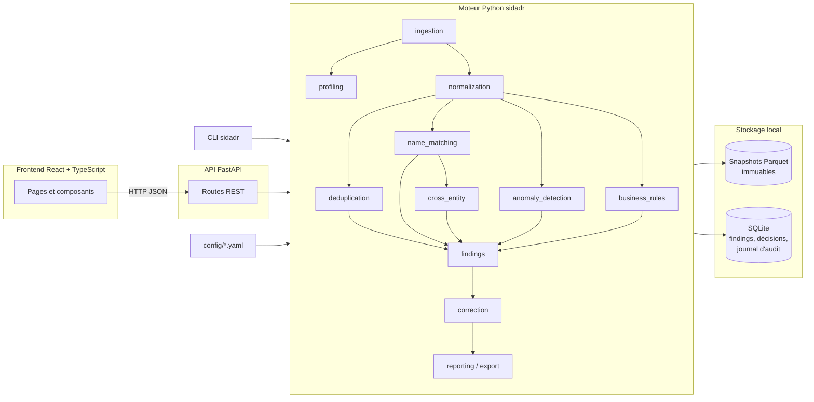

# SIDADR — Architecture technique

> Statut : **proposition Phase 1, en attente de validation.** Aucun code n'est encore écrit.
> SIDADR est un **prototype local mono-utilisateur** de qualité professionnelle, pas une application de production.

## 1. Principes directeurs

1. **Le moteur est indépendant de l'interface.** Toute la logique métier vit dans le paquet Python `sidadr`. L'API et le frontend ne font qu'appeler ce moteur. Le moteur est utilisable seul, en ligne de commande et en tests.
2. **Les données originales sont immuables.** Un fichier importé est figé en instantané (*snapshot*). Les corrections sont stockées à part, comme une couche de modifications appliquée à la lecture. Annuler une correction = désactiver une ligne de cette couche.
3. **Le système signale, l'humain décide.** Aucun détecteur ne supprime, ne fusionne ni ne corrige automatiquement. Chaque détection produit un *finding* (constat) qui attend une décision.
4. **Tout est explicable.** Chaque constat porte la règle déclenchée, la valeur observée, le seuil, et une explication en français.
5. **Les règles sont de la configuration.** Seuils, règles métier, poids du score qualité : fichiers YAML versionnés, pas de valeurs codées en dur.
6. **Pas de technologie sans besoin.** Voir § 8.

## 2. Vue d'ensemble



## 3. Structure du dépôt

```
SIDADR/
├── pyproject.toml            # dépendances, ruff, mypy, pytest
├── README.md
├── .env.example              # SIDADR_WORKSPACE, SIDADR_MAX_UPLOAD_MB… (aucun secret)
├── config/
│   ├── settings.yaml         # limites d'import, chemins, seuils par défaut
│   ├── quality_score.yaml    # dimensions et poids du score qualité
│   ├── matching.yaml         # seuils de similarité des noms + justification
│   ├── anomalies.yaml        # méthodes statistiques et paramètres
│   └── rules/
│       └── transactions.yaml # règles métier déclaratives
├── src/sidadr/
│   ├── ingestion/            # lecture CSV/XLSX, détection encodage/séparateur/types, mapping colonnes
│   ├── profiling/            # statistiques par colonne, score qualité
│   ├── normalization/        # normalisation des noms, montants, dates
│   ├── deduplication/        # doublons exacts (ligne, clé métier, multi-champs, inter-fichiers)
│   ├── name_matching/        # doublons probables de noms (RapidFuzz, blocking)
│   ├── cross_entity/         # clients potentiellement multi-banques / multi-agences
│   ├── anomaly_detection/    # z-score robuste, IQR, bornes métier, (option) Isolation Forest / LOF
│   ├── business_rules/       # moteur de règles YAML
│   ├── findings/             # modèle commun des constats + sévérités
│   ├── correction/           # couche de corrections, décisions, journal d'audit
│   ├── reporting/            # rapports qualité et corrections
│   ├── export/               # CSV / XLSX avec en-tête de traçabilité
│   ├── storage/              # SQLite (repository) + snapshots Parquet
│   ├── api/                  # application FastAPI (Phase 11)
│   └── cli.py                # `sidadr analyze data.csv --report out/`
├── scripts/
│   └── generate_synthetic_data.py
├── data/
│   └── synthetic/            # jeu généré + manifeste des défauts injectés
├── tests/
│   ├── unit/
│   ├── integration/
│   └── fixtures/
├── frontend/                 # Vite + React + TS (Phase 11)
├── docs/
│   ├── architecture/
│   ├── specs/
│   ├── design/
│   ├── data_dictionary/
│   └── user_guide/
└── .github/workflows/ci.yml  # ruff + mypy + pytest (+ build frontend plus tard)
```

Écart volontaire avec la structure proposée dans le brief : `ui/` est remplacé par `frontend/` (choix React validé) et `database/` par `storage/` (il couvre aussi les fichiers Parquet). `name_matching/` et `cross_entity/` sont séparés de `deduplication/` car ce sont des problèmes différents (exact contre probabiliste).

## 4. Modèle de données interne

### 4.1 Identité des enregistrements
À l'import, chaque ligne reçoit un `record_id` stable : `<import_id>:<numéro de ligne d'origine>`. Toutes les détections, décisions et corrections référencent ce `record_id`, jamais un index Pandas (qui change après un filtre ou un tri).

### 4.2 Constat (`Finding`)
Format commun à tous les détecteurs :

| Champ | Exemple | Rôle |
|---|---|---|
| `finding_id` | `F-000123` | identifiant |
| `kind` | `exact_duplicate`, `name_match`, `cross_entity`, `anomaly`, `rule_violation`, `format_error` | famille de détecteur |
| `severity` | voir § 4.3 | niveau de certitude/gravité |
| `record_ids` | `["imp1:42", "imp2:7"]` | enregistrements concernés |
| `field` | `amount` | champ concerné (si applicable) |
| `observed_value` | `-150000` | valeur observée |
| `rule_id` | `R-AMOUNT-NEG-DEPOSIT` | règle ou méthode déclenchée |
| `threshold` | `IQR k=3.0 → [−12 500 ; 980 000]` | seuil utilisé |
| `score` | `0.91` | score de similarité/anomalie si pertinent |
| `explanation` | phrase en français | pourquoi c'est signalé |
| `recommendation` | phrase en français | quoi vérifier |
| `status` | `open`, `confirmed`, `rejected`, `kept_both`, `corrected` | décision humaine |

### 4.3 Échelle de sévérité (exigence du brief)

| Niveau | Signification | Exemple |
|---|---|---|
| `certain_error` — **Erreur certaine** | viole une contrainte impossible à respecter | date `2024-02-31`, devise `XXX` hors référentiel |
| `probable_inconsistency` — **Incohérence probable** | viole une règle métier, mais une exception est possible | dépôt avec montant négatif |
| `atypical_value` — **Valeur atypique** | statistiquement rare, **pas une erreur en soi** | montant à 6 écarts-types |
| `review_alert` — **Alerte à examiner** | ressemblance qui demande un jugement humain | deux noms similaires dans deux banques |

Les détecteurs statistiques et de similarité ne peuvent **jamais** produire `certain_error`. Le mot « fraude » n'apparaît dans aucun libellé.

### 4.4 Corrections réversibles
```
original snapshot (Parquet, immuable)
   + corrections actives (SQLite: record_id, field, old, new, reason, author, ts, active)
   = vue de travail (calculée à la lecture)
```
Annuler = passer `active=false` et journaliser l'annulation. Aucune ligne n'est jamais supprimée physiquement ; « exclure un enregistrement » est une correction comme une autre (`excluded=true`).

### 4.5 Journal d'audit
Table `audit_log` en ajout seul : `id, ts_utc, session_id, actor, action_type, record_id, field, old_value, new_value, reason, finding_id`. Le motif (`reason`) est obligatoire pour toute correction, validation ou rejet.

## 5. Algorithmes clés (résumé — détail dans `docs/specs/ENGINE_SPEC.md`)

| Problème | Approche | Pourquoi |
|---|---|---|
| Doublons exacts | hachage des champs sélectionnés après normalisation légère (espaces, casse) ; regroupement | O(n), déterministe, explicable |
| Noms similaires | normalisation → *blocking* (clé phonétique/préfixe) → plusieurs scores RapidFuzz → score composite | éviter la comparaison de toutes les paires (O(n²)) ; plusieurs stratégies couvrent inversions, initiales, espaces manquants |
| Multi-banques | regroupement des correspondances de noms entre `bank_code` différents, renforcé ou affaibli par des champs corroborants (date de naissance, téléphone) | un nom seul ne prouve pas l'identité |
| Anomalies | z-score **robuste** (médiane/MAD) + IQR, par groupe (type d'opération, devise) + bornes métier ; Isolation Forest/LOF en option | explicable d'abord ; les montants financiers sont très asymétriques, le z-score classique y est trompeur |
| Règles métier | règles déclaratives YAML évaluées sur la vue de travail | modifiables sans toucher au code |
| Score qualité | moyenne pondérée de 4 dimensions (complétude, unicité, validité, cohérence), poids configurables | explicable et décomposable ; présenté comme un indicateur interne, pas une norme |

## 6. Persistance

- **Parquet** (via `pyarrow`) pour les snapshots : typé, compact, immuable, rechargement rapide.
- **SQLite** pour les métadonnées : imports, mappings de colonnes, findings, décisions, corrections, audit. Un fichier, zéro serveur, transactions ACID.
- Le dossier de travail (`SIDADR_WORKSPACE`, par défaut `./workspace/`) est ignoré par Git.

PostgreSQL n'est **pas** retenu : un seul utilisateur local, aucun accès concurrent. La couche `storage/` passe par un *repository* isolé ; migrer plus tard ne toucherait qu'elle.

## 7. API et frontend (Phase 11)

**Phase 11a livrée : API FastAPI** (`src/sidadr/api/app.py`, commande `sidadr serve`, documentation interactive sur `/api/docs`). L'API n'ajoute aucune logique métier : elle appelle le moteur.

| Méthode | Route | Rôle |
|---|---|---|
| GET | `/api/health`, `/api/schema` | état, schéma canonique |
| POST | `/api/imports` | téléversement et inspection (formats, aperçu, correspondance proposée) |
| POST | `/api/sessions` | création de session (vaut confirmation de la correspondance) |
| GET | `/api/sessions`, `/api/sessions/{id}` | liste, état (compteurs, analyse, fraîcheur, intégrité du journal) |
| POST | `/api/sessions/{id}/analyze` | analyse complète de la vue de travail |
| GET | `/api/sessions/{id}/findings` | constats filtrés, recherche, pagination, facettes |
| GET | `/api/sessions/{id}/findings/{fid}` | détail et enregistrements concernés |
| POST | `/api/sessions/{id}/findings/{fid}/decision` | décision motivée |
| GET | `/api/sessions/{id}/records`, `/records/{rid}` | données de travail (recherche sur toutes les colonnes du schéma, indicateurs exclu / champs corrigés) ; original, valeur actuelle et historique d'un enregistrement |
| POST | `/api/sessions/{id}/corrections`, `/exclusions`, `/undo` | actions motivées et réversibles |
| GET | `/api/sessions/{id}/history` | journal et vérification d'intégrité |
| GET | `/api/sessions/{id}/export`, `/report` | XLSX, CSV (zip), rapport HTML |

Sécurité : écoute sur 127.0.0.1 par défaut, CORS limité à l'origine du frontend de développement, noms de fichiers téléversés assainis, taille limitée, erreurs renvoyées en messages lisibles (422, 404, 409) sans trace technique, en-tête `Content-Security-Policy` strict sur le rapport. L'auteur des actions est transmis par l'en-tête `X-Sidadr-Actor` (déclaratif, sans authentification).

**Phases 11b à 11f livrées : interface React** (`frontend/`). Vite, React 19, TypeScript strict, Tailwind CSS 4 alimenté par les jetons du design system, React Router (filtres et sélection dans l'URL), TanStack Query (cache, états de chargement et d'erreur, invalidation après chaque action), icônes Lucide. Les types de l'API sont écrits à la main dans `src/api/types.ts` ; les tests Vitest simulent l'API et la CI vérifie types, tests et build.

Écrans : sessions, import, vue d'ensemble, constats (et vues Doublons, Noms & identités, Anomalies, Règles métier), corrections, historique, qualité des données, rapports & exports. Aucune logique métier côté navigateur : toute valeur saisie est validée par le moteur, qui renvoie un message lisible en cas de refus.

## 8. Choix technologiques et compromis

| Retenu | Rôle | Écarté / différé | Raison |
|---|---|---|---|
| Python 3.12 | moteur | — | version stable, compatible toutes dépendances |
| Pandas, NumPy | traitement | Polars, Spark | volumes visés ≤ 500 k lignes : Pandas suffit et c'est le standard attendu en entretien |
| RapidFuzz | similarité de chaînes | jellyfish seul | rapide (C++), Levenshtein + Jaro-Winkler + ratios tokenisés |
| openpyxl | lecture/écriture XLSX | xlrd | `.xlsx` uniquement, mode lecture seule |
| charset-normalizer | détection d'encodage | chardet | déjà dépendance indirecte, plus fiable |
| pyarrow | Parquet | — | snapshots immuables |
| PyYAML + Pydantic | config validée | — | erreurs de configuration détectées au démarrage |
| scikit-learn | Isolation Forest / LOF | — | **optionnel, Phase 7**, en complément des méthodes explicables |
| SQLite | métadonnées | PostgreSQL | pas de multi-utilisateur à justifier |
| FastAPI | API | Flask | validation Pydantic + OpenAPI natifs |
| pytest, ruff, mypy, GitHub Actions | qualité | — | standard |
| — | — | Docker | différé : utile seulement si on déploie |
| — | — | Airflow, dbt, Spark | hors sujet : SIDADR est une application interactive, pas un pipeline planifié |
| — | — | Storybook | coût supérieur au bénéfice pour un seul développeur |

## 9. Sécurité et confidentialité

- Extensions acceptées : `.csv`, `.xlsx` ; taille max configurable (défaut 50 Mo) ; vérification de la taille décompressée des XLSX (protection *zip bomb*).
- Lecture XLSX en `read_only`, sans évaluation de formules.
- **Injection de formules à l'export** : toute cellule commençant par `=`, `+`, `-`, `@` est préfixée d'une apostrophe dans les exports CSV/XLSX.
- Les journaux techniques ne contiennent ni noms, ni montants, ni identifiants clients : uniquement `record_id`, compteurs et codes de règle.
- API liée à `127.0.0.1` par défaut ; CORS limité à l'origine du frontend local.
- Aucune donnée réelle dans le dépôt ; `.gitignore` exclut `workspace/`, `*.parquet` hors `data/synthetic/`, `.env`.

## 10. Limites assumées

- Prototype local mono-utilisateur, sans authentification.
- L'appariement de noms produit des faux positifs et des faux négatifs ; il est mesuré sur données synthétiques, ce qui **ne garantit pas** les mêmes performances sur des données réelles.
- Les algorithmes phonétiques disponibles sont conçus pour l'anglais ; leur pertinence sur des noms d'Afrique centrale est limitée et sera documentée.
- Les chiffres issus du stage BEAC (500 000+ lignes, −35 % d'erreurs) relèvent du contexte d'origine et ne sont pas reproduits par ce dépôt.
