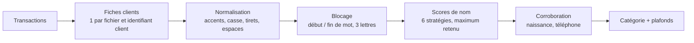

# SIDADR — Rapprochement des noms (module D) : méthode, calibration, limites

> Statut : **livré en Phase 5.** Code : `src/sidadr/name_matching/`. Configuration : `config/matching.yaml`.
> Mesure reproductible : `python scripts/evaluate_name_matching.py --data data/synthetic`.

## 1. Principe

Une similarité de nom **ne prouve pas** une identité. Le module produit des **alertes à examiner**, classées par niveau de similarité ; il ne fusionne et ne modifie jamais rien.

1. **Fiches clients** : les noms sont comparés entre clients, pas entre transactions (2 710 fiches au lieu de 20 200 lignes).
2. **Normalisation** : `Jean-Pierre  MANGA` → `JEAN PIERRE MANGA`.
3. **Blocage** : deux fiches ne sont comparées que si elles partagent le début ou la fin (3 lettres) d'un mot. La fin de mot rattrape une faute au début d'un nom (`MRNGA` / `MANGA`). On passe ainsi de 3,7 millions de paires possibles à 358 000 paires comparées, **sans perdre une seule vraie paire** sur le jeu de référence.
4. **Stratégies** (0 à 100), le maximum est retenu et **la stratégie gagnante est affichée** :

| Stratégie | Cas couvert | Exemple |
|---|---|---|
| `exact_normalized` | casse, accents, tirets, espaces | `Jean-Pierre Manga` / `JEAN PIERRE MANGA` |
| `token_sort` | ordre nom / prénom | `MANGA JEAN PIERRE` / `JEAN PIERRE MANGA` |
| `levenshtein` | fautes de frappe (distance d'édition, mots triés) | `MRNGA CEDRIC` / `MANGA CEDRIC` |
| `jaro_winkler` | fautes de frappe, **mot par mot, en retenant le mot le moins ressemblant** | idem |
| `collapsed` | mots collés ou séparés, dans toutes les rotations | `JEANPIERRE MANGA` / `MANGA JEAN PIERRE` |
| `initials_compatible` | prénoms abrégés (score fixe, configurable) | `J. P. MANGA` / `MANGA Jean Pierre` |

5. **Corroboration** : date de naissance identique +5, différente −25 ; téléphone identique +5, différent −10. Les téléphones sont comparés sur leurs 9 derniers chiffres, car les indicatifs pays varient d'un système à l'autre (`+999 628…`, `00999628…`, `628…`).
6. **Catégories** sur le score final : élevée ≥ 92, intermédiaire ≥ 88, faible ≥ 80.
7. **Plafonds** :
   - sans aucun champ corroborant comparable, une paire est **au plus intermédiaire** : deux homonymes seraient indiscernables ;
   - si un champ corroborant diverge, la paire est **au plus faible** : elle reste visible, car un téléphone peut changer, mais n'est plus prioritaire.

## 2. Choix écartés, et pourquoi

| Écarté | Raison |
|---|---|
| `token_set_ratio` | donne 100 à `MANGA Jean` face à `MANGA Jean Pierre`, deux personnes possiblement distinctes |
| Jaro-Winkler sur le nom entier | favorise trop les débuts communs : `ABENA JEAN` / `ABENA JOEL` dépassait 90 ; mot par mot, il tombe à 78 |
| Comparaison phonétique (Soundex, Metaphone) | algorithmes conçus pour l'anglais, peu pertinents pour des noms d'Afrique centrale ; les fautes de frappe sont déjà couvertes par la distance d'édition |
| Fusion automatique au-delà d'un seuil | contraire au principe du projet : l'humain décide |

## 3. Calibration (jeu de référence, graine 42)

La première version, sans plafonds et avec Jaro-Winkler sur le nom entier, retrouvait toutes les vraies paires, mais la précision de la catégorie « élevée » n'était que de **49 %**. L'analyse des faux positifs a montré deux causes : des homonymes sans champ corroborant, et un Jaro-Winkler trop indulgent. Les deux corrections décrites plus haut donnent :

| Catégorie (cumulée) | Paires prédites | Vrais positifs | Faux positifs | Oubliés | Précision | Rappel |
|---|---:|---:|---:|---:|---:|---:|
| Élevée | 147 | 147 | 0 | 24 | **100 %** | 86,0 % |
| ≥ Intermédiaire | 260 | 171 | 89 | 0 | 65,8 % | **100 %** |
| ≥ Faible | 680 | 171 | 509 | 0 | 25,1 % | 100 % |

- 171 vraies paires (même personne, deux fiches) ; rappel du blocage : 100 %.
- 0 des 40 paires d'homonymes injectées n'est classée en similarité élevée.
- Les 24 vraies paires absentes de la catégorie « élevée » sont toutes des paires **non vérifiables** (aucune date de naissance ni téléphone commun) : elles sont plafonnées en intermédiaire par conception.
- Les 89 faux positifs « intermédiaires » sont des **homonymes naturels non vérifiables** : avec 40 prénoms et 40 noms, beaucoup de clients distincts portent le même nom. Aucun algorithme fondé sur le nom ne peut les distinguer ; c'est précisément pourquoi ils restent des alertes à examiner.

**Contrôle du surapprentissage** : les seuils ont été choisis sur la graine 42, puis vérifiés sans modification sur deux autres jeux générés :

| Graine | Précision « élevée » | Rappel « élevée » | Rappel ≥ intermédiaire |
|---|---:|---:|---:|
| 42 (calibration) | 100 % | 86,0 % | 100 % |
| 123 | 100 % | 87,8 % | 100 % |
| 2024 | 100 % | 90,6 % | 100 % |

## 4. Limites à connaître

- Les variantes de noms sont **générées par le même projet** qui les détecte. Les performances mesurées ici ne garantissent pas les mêmes performances sur des données réelles, où les erreurs de saisie sont plus variées (noms de jeune fille, translittérations, surnoms).
- Deux homonymes sans date de naissance ni téléphone ne peuvent pas être distingués. Le module le dit, plafonne la catégorie et laisse la décision à l'utilisateur.
- Le score d'initiales est fixe (88) : `J. MANGA` est compatible avec tous les clients `MANGA` dont un prénom commence par J.
- Un bloc de plus de 600 fiches partageant une même clé est ignoré et signalé (aucun sur le jeu de référence) ; sur de gros volumes, il faudra un blocage plus fin.
